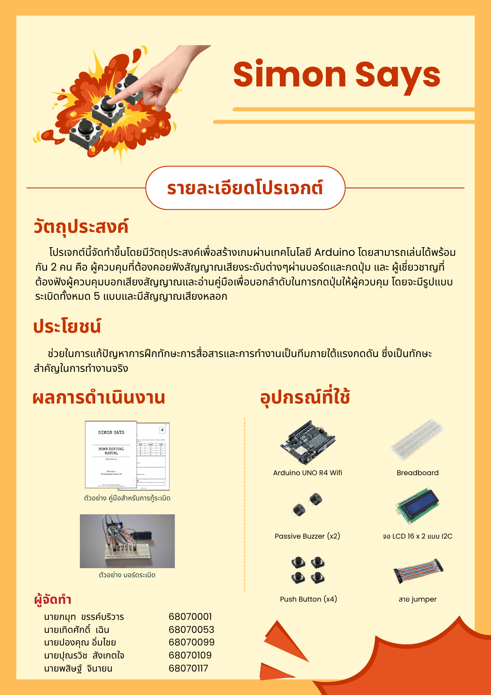

> This game is currently a project under **Physical Computing Project 2026 - IT KMITL**

# Bakuduino: Simon Says

**เกมกู้ระเบิดจำลองบน Arduino ที่ต้องอาศัยการฟัง การสื่อสาร และการทำงานเป็นทีม**

Bakuduino เป็นเกมสำหรับผู้เล่นสองคน คนหนึ่งอยู่กับเครื่อง เห็นจอและได้ยินเสียง แต่ไม่มีคู่มือ อีกคนถือคู่มือที่บอกวิธีถอดรหัส แต่ไม่เห็นเครื่อง ทั้งคู่ต้องบอกข้อมูลให้ตรงกันและช่วยกันหาลำดับปุ่มที่ถูกต้องก่อนหมดเวลา

ชื่อ **Bakuduino** มาจากคำว่า *Bakudan* (ระเบิด) และ *Arduino* ส่วนเกมในโครงงานใช้ชื่อ **Simon Says** แนวคิดการแบ่งข้อมูลระหว่างผู้เล่นได้รับแรงบันดาลใจจาก [Keep Talking and Nobody Explodes](https://keeptalkinggame.com/) แต่เราเปลี่ยนโจทย์หลักมาเป็นเสียง เพิ่มเสียงหลอก และให้แต่ละสัญลักษณ์มีกฎของตัวเอง

## บทคัดย่อ

โครงงานนี้สร้างเกมกู้ระเบิดจำลองบน Arduino เพื่อให้ผู้เล่นฝึกอธิบายสิ่งที่เห็นและได้ยิน ฟังเพื่อนให้เข้าใจ และตัดสินใจร่วมกันภายใต้เวลาจำกัด เครื่องต้นแบบใช้ Arduino UNO R4 WiFi ร่วมกับจอ LCD ปุ่มกด 4 ปุ่ม และ passive buzzer ผู้เล่นต้องผ่าน 5 ด่านภายใน 5 นาที โดยฟังเสียงต่ำ กลาง สูง แยกเสียงหลอก และตอบด้วยปุ่มตามกฎของสัญลักษณ์ในแต่ละด่าน โปรแกรมสุ่มลำดับด่าน ตรวจคำตอบ จับเวลา และนับจำนวนครั้งที่ผิด ต้นแบบปัจจุบันเล่นเกมหลักได้ครบ ส่วนระบบเร่งเวลาเมื่อกดผิดและเหตุการณ์สุ่มที่เคยวางแผนไว้ยังไม่รวมในรุ่นนี้

## เกมทำอะไรได้บ้าง

- สุ่มลำดับสัญลักษณ์ทั้ง 5 ด่านใหม่เมื่อเริ่มเกม
- เล่นลำดับเสียงต่ำ กลาง สูง และเสียงหลอก
- แสดงสัญลักษณ์ ด่าน เวลา และจำนวนครั้งที่ผิดบนจอ LCD
- รับคำตอบจากปุ่ม 4 ปุ่ม และตรวจตามกฎเฉพาะของแต่ละสัญลักษณ์
- จบเกมเมื่อผ่านครบ 5 ด่าน เวลาหมด หรือผิดครบ 3 ครั้ง

[อ่านรายงานโครงงาน](docs/index.md) · [เปิดคู่มือ Simon Says (PDF)](Simon%20Says%20Manual.pdf)

## อุปกรณ์ที่ใช้

| อุปกรณ์ | จำนวน | หน้าที่ |
| --- | ---: | --- |
| Arduino UNO R4 WiFi | 1 | ควบคุมเกมและอ่านข้อมูลจากอุปกรณ์ |
| LCD 16 × 2 พร้อมโมดูล I²C | 1 | แสดงสัญลักษณ์ เวลา และสถานะ |
| ปุ่มกด | 4 | ใช้ตอบลำดับคำสั่ง |
| Passive buzzer | 2 | เล่นโจทย์เสียงและเสียงแจ้งผล |
| เบรดบอร์ดและสายจัมเปอร์ | ตามที่ใช้ | ต่อวงจรต้นแบบ |
| สาย USB | 1 | จ่ายไฟและอัปโหลดโปรแกรม |

รายละเอียดการต่ออุปกรณ์อยู่ใน [หน้าอุปกรณ์และวงจร](docs/hardware.md)

## ซอฟต์แวร์และไลบรารี

- **PlatformIO และ Arduino framework** สำหรับพัฒนาและอัปโหลดโปรแกรมลง Arduino UNO R4 WiFi
- **[LiquidCrystal_I2C](https://github.com/johnrickman/LiquidCrystal_I2C)** สำหรับสั่งงานจอ LCD ผ่าน I²C
- ฟังก์ชัน **[tone()](https://docs.arduino.cc/language-reference/en/functions/advanced-io/tone/)** ของ Arduino สำหรับสร้างเสียง

การตั้งค่าบอร์ดและไลบรารีอยู่ใน [platformio.ini](platformio.ini) ส่วนโค้ดเกมอยู่ในโฟลเดอร์ [src/](src/)

## วิธีเริ่มใช้งาน

1. ดาวน์โหลดหรือ clone repository นี้ แล้วเปิดโฟลเดอร์โครงงานใน VS Code ที่ติดตั้ง PlatformIO
2. ต่ออุปกรณ์ตาม [หน้าอุปกรณ์และวงจร](docs/hardware.md) และตรวจสายก่อนจ่ายไฟ
3. ใช้ PlatformIO Build และ Upload โปรแกรมลง Arduino UNO R4 WiFi
4. ให้ผู้เล่นคนหนึ่งอยู่กับเครื่อง ส่วนอีกคนเปิด [คู่มือถอดรหัส](Simon%20Says%20Manual.pdf) แล้วกดปุ่มเพื่อเริ่มเกม

หากติดปัญหาระหว่างติดตั้ง ดู [ขั้นตอนติดตั้งโดยละเอียด](docs/installation.md)

## โปสเตอร์ A1

[ดาวน์โหลดโปสเตอร์ขนาด A1 (PDF)](docs/assets/Bakuduino_Poster_A1.pdf)

## วิดีโอสาธิต

วิดีโอสาธิตการเล่นจะเพิ่มในส่วนนี้หลังจากถ่ายและตัดต่อเสร็จ

## สมาชิกในทีม

| รหัสนักศึกษา | ชื่อ | หน้าที่ |
| --- | --- | --- |
| 68070109 | นายปุณรวิช สังเกตใจ | ต่อวงจรและจัดการฮาร์ดแวร์ |
| 68070001 | นายกมุท ขรรค์บริวาร | ออกแบบคู่มือและธีมเรื่องราว |
| 68070053 | นายเทิดศักดิ์ เฉิน | เขียนตรรกะเกม ระบบเวลา และ strike |
| 68070099 | นายปองคุณ อิ่มไชย | เขียนส่วนจอ เสียง และปุ่ม |
| 68070117 | นายพสิษฐ์ จินายน | ทดสอบการเล่นและปรับความยาก |

รายละเอียดอุปสรรคและสิ่งที่ยังไม่ได้ทำอยู่ใน [รายงานการพัฒนา](docs/development.md)

## อ้างอิงและสิทธิ์การใช้งาน

- [Keep Talking and Nobody Explodes](https://keeptalkinggame.com/) และ [คู่มือเกมต้นฉบับ](https://www.bombmanual.com/) — แรงบันดาลใจด้านการเล่นร่วมกัน
- [Arduino Reference: tone()](https://docs.arduino.cc/language-reference/en/functions/advanced-io/tone/)
- [LiquidCrystal_I2C](https://github.com/johnrickman/LiquidCrystal_I2C)

ซอร์สโค้ดใน repository นี้เผยแพร่ภายใต้ [GNU General Public License v3.0](LICENSE)