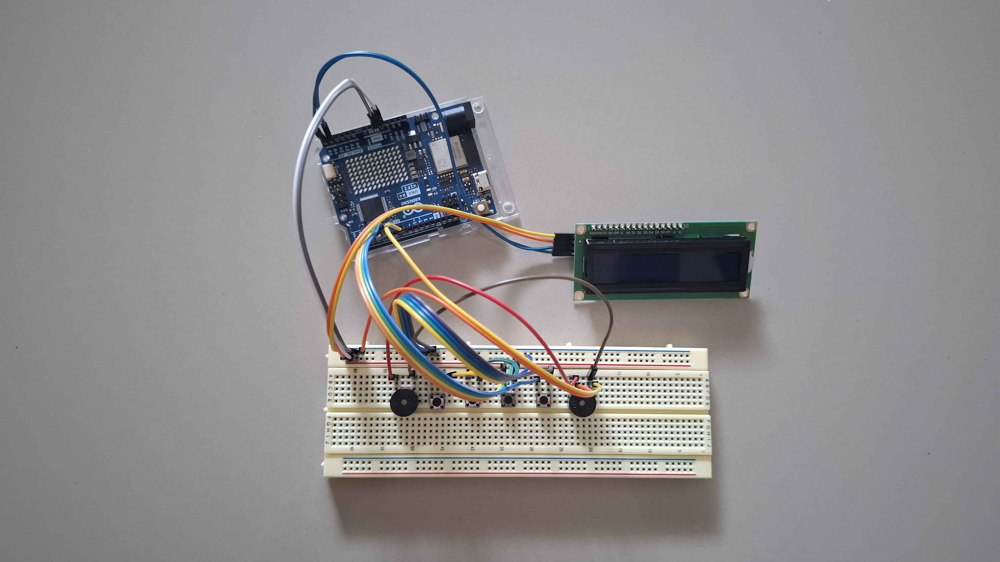

# อุปกรณ์และวงจร

หน้านี้ใช้ภาพเครื่องจริงประกอบกับค่าที่ระบุไว้ในโค้ด เพื่อให้เห็นว่าชิ้นส่วนแต่ละตัวทำหน้าที่อะไร ก่อนต่อวงจรควรปิดการจ่ายไฟและตรวจขาของอุปกรณ์ที่มีอยู่จริง เพราะโมดูลจอและอุปกรณ์ส่งเสียงต่างรุ่นอาจจัดขาไม่เหมือนกัน

## อุปกรณ์หลัก

| อุปกรณ์ | จำนวน | หน้าที่ |
| --- | ---: | --- |
| Arduino UNO R4 WiFi | 1 | ควบคุมด่าน สุ่มสัญญาณ อ่านปุ่ม และสั่งจอกับเสียง |
| จอ LCD 16 × 2 พร้อมโมดูล I²C | 1 | แสดงสัญลักษณ์ ด่าน เวลา ความคืบหน้า และ X |
| ปุ่มกด | 4 | รับคำตอบหมายเลข 1–4 |
| อุปกรณ์ส่งเสียงหรือ buzzer ที่ใช้กับฟังก์ชัน `tone()` | 1 | เล่นเสียงต่ำ กลาง สูง เสียงติ๊ก และเสียงแจ้งผล |
| เบรดบอร์ดและสายจัมเปอร์ | ตามการประกอบ | เชื่อมวงจรโดยไม่ต้องออกแบบแผ่นวงจรเฉพาะ |
| สาย USB สำหรับบอร์ด | 1 | จ่ายไฟและอัปโหลดโปรแกรม |

รายการนี้อ้างอิงจาก [ภาพเครื่องจริง](assets/bakuduino-hardware.jpg), [การกำหนดขาในโปรแกรม](https://github.com/BankTQMA/Bakuduino/blob/main/src/ModuleWave.h) และ [ไฟล์ตั้งค่าบอร์ด](https://github.com/BankTQMA/Bakuduino/blob/main/platformio.ini) ถ้าอุปกรณ์ที่ใช้จริงเปลี่ยน ให้ปรับตารางตามวงจรที่ประกอบ

## การเชื่อมต่อที่โปรแกรมคาดหวัง

| ส่วน | ขา Arduino หรือค่า | หมายเหตุ |
| --- | --- | --- |
| ปุ่ม 1 | D2 | อ่านเมื่อกดลงเป็น `LOW` |
| ปุ่ม 2 | D3 | อ่านเมื่อกดลงเป็น `LOW` |
| ปุ่ม 3 | D4 | อ่านเมื่อกดลงเป็น `LOW` |
| ปุ่ม 4 | D5 | อ่านเมื่อกดลงเป็น `LOW` |
| อุปกรณ์ส่งเสียง | D8 | ใช้ฟังก์ชัน `tone()` |
| จอ LCD | I²C address `0x27` | ขนาด 16 คอลัมน์ × 2 แถว |

ตัวแปร `buttonPins[4] = {2, 3, 4, 5}` และ `buzzerPin = 8` อยู่ใน [ModuleWave.h](https://github.com/BankTQMA/Bakuduino/blob/main/src/ModuleWave.h) ส่วนการตั้งปุ่มเป็น `INPUT_PULLUP` อยู่ใน [main.cpp](https://github.com/BankTQMA/Bakuduino/blob/main/src/main.cpp) จึงควรต่อปุ่มให้ขาที่อ่านอยู่ถูกดึงลงกราวด์เมื่อกด และติดเลข **1–4** ให้ตรงกับลำดับที่โปรแกรมอ่าน

จอเชื่อมต่อด้วย I²C ให้ตรวจชื่อขา **VCC, GND, SDA และ SCL** บนโมดูลจอและบอร์ดจริงก่อนเสียบสาย ภาพถ่ายช่วยบอกตำแหน่งอุปกรณ์ แต่ไม่ใช่ผังสายไฟทุกเส้น

## สิ่งที่ผู้เล่นมองเห็นและสัมผัส

- **จอ:** มุมซ้ายบนเป็นสัญลักษณ์ ป้าย `ST2/5` หมายถึงด่าน 2 จาก 5 ส่วนเวลาอยู่ด้านขวา
- **บรรทัดล่าง:** `*` หมายถึงตอบถูกไปแล้วหนึ่งตัว `-` หมายถึงคำตอบที่ยังเหลือ
- **เครื่องหมาย X:** แสดงจำนวนครั้งที่กดผิดสะสม
- **ปุ่ม:** ผู้เล่นกดตามหมายเลข 1 ถึง 4 จากซ้ายไปขวา เมื่อจัดเครื่องในทิศทางตามภาพ
- **เสียง:** เป็นข้อมูลของโจทย์และเป็นเสียงตอบรับเมื่อกดหรือผ่านด่าน

รูปแบบจอและการอ่านปุ่มอยู่ใน [ModuleEye.h](https://github.com/BankTQMA/Bakuduino/blob/main/src/ModuleEye.h)

## ลำดับตรวจเครื่องก่อนเล่น

1. ต่ออุปกรณ์ให้ครบและตรวจสายไฟด้วยตาอีกครั้ง
2. จ่ายไฟให้บอร์ด จอควรติดและแสดงหน้ารอ
3. กดปุ่มแต่ละปุ่มเพื่อยืนยันว่าหมายเลขบนป้ายตรงกับขาที่โปรแกรมอ่าน
4. เริ่มเกมหนึ่งครั้งเพื่อลองฟังเสียงทั้งสามระดับและเสียงติ๊ก
5. วางเครื่องให้ผู้ควบคุมเห็นจอและเอื้อมถึงปุ่ม ส่วนผู้เชี่ยวชาญต้องมองไม่เห็นเครื่อง

ถ้าจอว่าง เสียงไม่ออก หรือปุ่มไม่ตอบสนอง ให้เปิด [คำถามที่พบบ่อย](faq.md) ก่อนเปลี่ยนโค้ด

